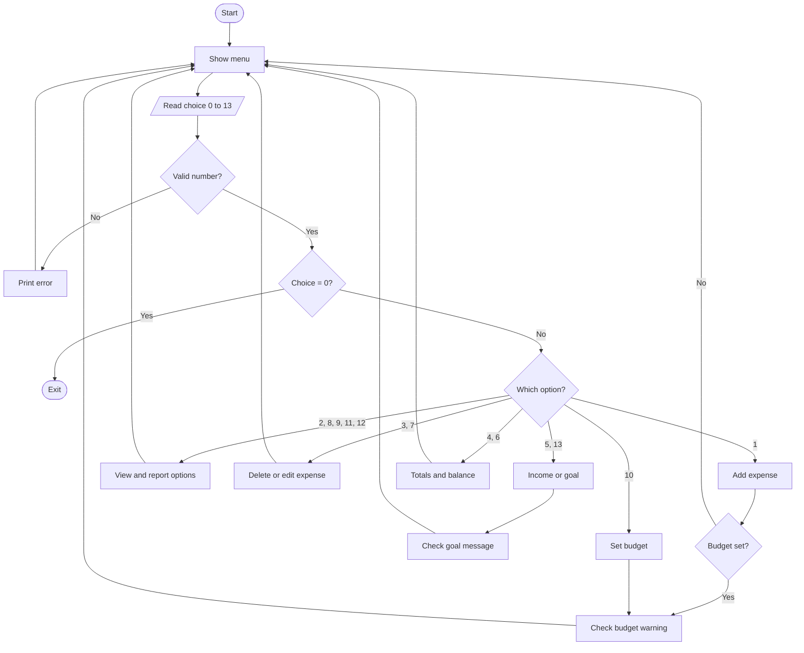

# Smart Expense Tracker

> A beginner-friendly personal expense tracker written in C.

---

## 1. Problem Statement

Many students and young people spend money every day (food, travel, bills, shopping) without keeping a record. By the end of the month they do not know where their money went, whether they stayed within their budget, or whether they are close to their savings target.

This project is a menu-driven C program that records income and expenses, shows how much has been spent in each category, warns the user when spending crosses a monthly budget, and tells the user when a savings goal has been reached.

---

## 2. Team Details

## 2. Team Details

| Field | Details |
|---|---|
| Team Name | Array of Three |
| Batch | 11/12 |
| Course / Program | Btech CSE |


| # | Member Name | Roll No. / Enrollment No. | Role |
|---|---|---|---|
| 1 | Yashvee Sharma | 590032014 |
| 2 | Kushaj Sharma | 590034159 | 
| 3 | Vedansh Swami | 590032849 |

---

## 3. Objectives and Features

### Objectives
1. Build a simple, working program that helps a user track personal money.
2. Practise core C concepts: structures, arrays, functions, loops and decision making.
3. Make the program reliable by rejecting wrong input instead of crashing.

### Features

| Menu No. | Feature | What it does |
|---|---|---|
| 1 | Add expense | Stores amount, category and a one-word note. |
| 2 | View expenses | Shows all expenses in a numbered table. |
| 3 | Delete expense | Removes the chosen expense. |
| 4 | Show totals | Shows total spent and the total for one category. |
| 5 | Add income | Records money received. |
| 6 | Show balance | Shows income, spent, balance, budget left and goal status. |
| 7 | Edit expense | Replaces the details of an existing expense. |
| 8 | Highest expense | Shows the single biggest expense. |
| 9 | Show one category | Lists only the expenses of one category. |
| 10 | Set monthly budget | Warns at 80% used and when the budget is exceeded. |
| 11 | Average expense | Shows the average amount per expense. |
| 12 | Category percentages and chart | Shows each category's share with a text bar chart. |
| 13 | Set savings goal | Shows "GOAL REACHED" when the balance passes the target. |
| 0 | Exit | Closes the program. |

Other points:
- Fixed category menu (Food, Travel, Bills, Fun, Shopping, Other), so spelling mistakes cannot create new categories.
- Input checks: letters, zero, negative numbers and out-of-range choices are rejected and the question is asked again.

---

## 4. Algorithm / Pseudocode and Flowchart

### Main program (pseudocode)

```
START
  set count = 0, income = 0, budget = 0, goal = 0
  REPEAT
    show the menu
    read choice (must be 0 to 13)
    IF choice = 1  THEN add an expense
    IF choice = 2  THEN view all expenses
    IF choice = 3  THEN delete an expense
    IF choice = 4  THEN show totals
    IF choice = 5  THEN add income
    IF choice = 6  THEN show balance
    IF choice = 7  THEN edit an expense
    IF choice = 8  THEN show highest expense
    IF choice = 9  THEN show one category
    IF choice = 10 THEN set budget
    IF choice = 11 THEN show average expense
    IF choice = 12 THEN show category percentages and chart
    IF choice = 13 THEN set savings goal
  UNTIL choice = 0
END
```

### Add expense (pseudocode)

```
IF list is full THEN print "List is full" and stop
read amount (must be 1 to 1000000)
read category from the category menu
read note
store them in the next free place in the list
count = count + 1
IF budget is set THEN
    IF total spent > budget THEN print over-budget warning
    ELSE IF total spent >= 80% of budget THEN print caution message
```

### Delete expense (pseudocode)

```
IF list is empty THEN print "Nothing to delete" and stop
show the list
read the number n to delete (must be 1 to count)
FOR each position from n to the end
    copy the next expense into this position
count = count - 1
```

### Category percentage (pseudocode)

```
total = total spent
IF total = 0 THEN print "No expenses yet" and stop
FOR each category
    sum = total of that category
    percent = sum * 100 / total
    print name, sum, percent
    print one # for every 5 percent
```

### Flowchart



---

## 5. C Programming Concepts Used

| Concept | Where it is used |
|---|---|
| Header files (`stdio.h`, `stdlib.h`) | Input/output and `exit()` |
| Macros (`#define`) | `MAX` (100 expenses) and `NCAT` (6 categories) |
| Variables and data types (`int`, `char`, `float`) | Amounts, counts, balance, average |
| Global variables | `list`, `count`, `income`, `budget`, `goal` |
| Structures (`struct`) | `struct Expense` stores amount, category and note together |
| Arrays | Array of expenses, array of category names, note text |
| Functions | One function per feature, plus helpers such as `readInt` |
| Return values and parameters | `readInt`, `totalSpent`, `categoryTotal` |
| Loops (`for`, `while`, `do-while`) | Menu loop, totals, tables, bar chart, input checks |
| Decision making (`if`, `else if`) | Budget and goal messages, input validation |
| `switch-case` | Menu selection |
| Operators (arithmetic, relational, logical) | Totals, percentages, `\|\|` in range checks |
| Type casting | `(float)` when calculating the average |
| Formatted input/output | `printf` and `scanf` with width and precision |
| Pointers (basic) | `scanf` addresses (`&`) and the `const char *` array of names |

---

##6. Using the program
1. Type the number of a menu option and press Enter.
2. Follow the prompts. Type numbers only where a number is asked.
3. Notes are one word (for example `pizza`).
4. Type `0` to exit. Data is kept in memory only, so it is cleared when the program closes.

---

## 7. Sample Test Cases (Expected vs Actual)

Menu numbers are typed after `Choose:`. Replace the "Actual" outputs with your own if they differ on your machine, and add a screenshot in `screenshots/`.

| ID | Test | Result |
|---|---|---|
| TC1 | Add income and show balance | [Pass / Fail] |
| TC2 | Add an expense and view it | [Pass / Fail] |
| TC3 | Wrong input is rejected | [Pass / Fail] |
| TC4 | Budget warnings | [Pass / Fail] |
| TC5 | Category percentages and chart | [Pass / Fail] |
| TC6 | Savings goal reached | [Pass / Fail] |
| TC7 | Delete an expense | [Pass / Fail] |
| TC8 | Highest and average expense | [Pass / Fail] |

### TC1: Add income and show balance
**Input:** option `5`, amount `5000`, then option `6`

**Expected output**
```
Income added!
Income : 5000
Spent  : 0
Balance: 5000
```
**Actual output**
```
Income added!
Income : 5000
Spent  : 0
Balance: 5000
```

### TC2: Add an expense and view it
**Input:** option `1`, amount `250`, category `1` (Food), note `pizza`, then option `2`

**Expected output**
```
Expense added!

No.  Amount  Category   Note
1    250     Food       pizza
```
**Actual output**
```
Expense added!

No.  Amount  Category   Note
1    250     Food       pizza
```

### TC3: Wrong input is rejected
**Input:** at the menu type `abc`; then option `1` and amount `-5`, then `250`

**Expected output**
```
Please type a number.
Please enter a number from 1 to 1000000.
(the program asks for the amount again and accepts 250)
```
**Actual output**
```
Please type a number.
Amount: Please enter a number from 1 to 1000000.
Amount: (accepts 250 and continues to the category menu)
```

### TC4: Budget warnings
**Input:** option `10` budget `300`; add expense `250`; add expense `120`

**Expected output**
```
Budget set to 300.
Careful: you have used 80% or more of your budget.
WARNING: You are over budget by 70!
```
**Actual output**
```
Budget set to 300.
Careful: you have used 80% or more of your budget.
WARNING: You are over budget by 70!
```

### TC5: Category percentages and chart
**Input:** add `250` Food, `120` Travel, `90` Fun; then option `12`

**Expected output**
```
Spending by category (each # = 5%)
Food         250   54%  ##########
Travel       120   26%  #####
Bills          0    0%
Fun           90   19%  ###
Shopping       0    0%
Other          0    0%
```
**Actual output**
```
Spending by category (each # = 5%)
Food         250   54%  ##########
Travel       120   26%  #####
Bills          0    0%
Fun           90   19%  ###
Shopping       0    0%
Other          0    0%
```

### TC6: Savings goal reached
**Input:** option `13` goal `4000`; option `5` income `5000`

**Expected output**
```
Goal set to 4000.
Savings goal: you still need 4000 more.
Income added!
GOAL REACHED! Your balance 5000 has passed your goal 4000.
```
**Actual output**
```
Goal set to 4000.
Savings goal: you still need 4000 more.
Income added!
GOAL REACHED! Your balance 5000 has passed your goal 4000.
```

### TC7: Delete an expense
**Input:** add `250` Food pizza and `120` Travel bus; option `3`, delete number `1`; then option `2`

**Expected output**
```
Deleted.

No.  Amount  Category   Note
1    120     Travel     bus
```
**Actual output**
```
Deleted.

No.  Amount  Category   Note
1    120     Travel     bus
```

### TC8: Highest and average expense
**Input:** add `250` Food pizza and `120` Travel bus; option `8`; option `11`

**Expected output**
```
Biggest expense: 250 on Food (pizza)
Average expense: 185.00
```
**Actual output**
```
Biggest expense: 250 on Food (pizza)
Average expense: 185.00
```

[Add more test cases here if you wish, for example an empty list, or choosing a menu number above 13.]

---

## 8. Repository Structure

```
Batch[XX]_Team[XX]_SmartExpenseTracker/
├── README.md
├── expense_tracker.c
├── presentation.pptx
├── flowchart.png
└── screenshots/
    └── sample_output.png
```

Repository name format: `Batch_TeamNo_ProblemName` (for example `Batch01_Team01_SmartExpenseTracker`).

---

## 9. Limitations and Future Scope

**Current limitations**
- Data is not saved when the program closes.
- Notes must be a single word.
- A maximum of 100 expenses can be stored.
- Expenses do not have dates.

**Possible improvements**
- Save and load data using file handling.
- Add a date to every expense and a monthly view.
- Sort expenses from highest to lowest.
  
